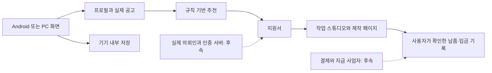

# aiworkjob 첫 버전

AI 도구를 사용하는 사람이 자신의 역량에 맞는 외주를 발견하고 지원부터 납품·정산까지 흐름을 이해하는 Android 앱. 첫 범위는 한국어 기반 프로젝트형 일감이며 장기 채용은 후속 범위다.

## 화면 설계

- 색: Paper #F7F8FC, Ink #202333, Work blue #4B52E7, Soft iris #ECEEFF, Mint #D7F3E7.
- 글꼴: 번들 Pretendard Variable. 제목 36/44px, 본문 14/22px, 금액은 굵은 숫자로 읽기 쉽게 표현.
- 배치: 왼쪽 고정 탐색 / 가운데 일감과 작업 / 오른쪽 역량·수익 안내. 모바일에서는 한 열과 하단 탐색.
- 특징: AI 기술 이름보다 산출물·보수·작업 기간·추천 이유를 먼저 보여준다. 첫 수익 경로와 일감 목록이 중심이며 순위·성공률·가짜 활동량을 만들지 않는다.
- 검토: 장식용 통계와 일반적인 구독형 서비스 영웅 영역을 제외했다. 작업 지시서 모양의 시각 요소와 실제 지원 동작에 시각적 비중을 둔다.

```text
PC:   탐색 | 인사·프로필 / 첫 일감 안내              | 수익 경로
           | 검색·분야 / 일감 목록                   | 역량·활용 도구
모바일: 로고·일감 등록 / 첫 일감 안내 / 검색·일감 / 하단 탐색
```

## 구현 전 상태와 목표

초기 상태: 새 프로젝트이며 서비스·공고 공급·결제 연결 없음.

최종 범위: Himalayas 실제 공고, 조건별 규칙 추천, 검색·저장, 프로필, 지원 메시지, 작업 상태·납품 URL·입금 사실 기록. 수락 후 실제 지원 링크·분야별 작업 스튜디오·제작 화면 링크를 제공한다. 사용자 추가 설명에 따라 예시 공고·체험 정산 설계는 실제 공고 탐색과 개인 기록으로 대체했다.

미연결: 국내 API 인증, 여러 사용자 사이의 계약, 프로필 클라우드 동기화, 서버 생성형 AI, 결제·에스크로·실제 계좌 정산. 매칭 점수는 초기 조건 비교이며 채용 확률이 아니다.



외부 지원과 금전 이동은 해당 원문 서비스에서 이루어진다. 지원·계약·입금은 사용자가 확인한 사실로 저장하며 자동 확정 상태를 만들지 않는다.
