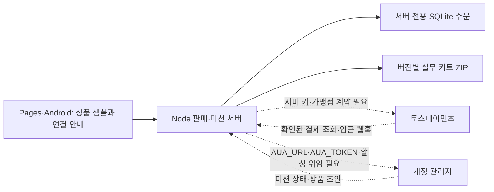

# 수익화·계정 관리자 연동

사용자 방향: 2026-10-29에 aiworkjob과 계정 관리자를 함께 개발하고, 사용자 위임 범위 안에서 실행한다. B에서 개발하고 검증 후 commonn의 승격 도구로 A를 갱신한다. 실제 계좌 개설·가맹점 계약·고객 구매·은행 정산은 코드가 있다는 사실로 대체하지 않는다.

## 이번 상품

`AI 일감 실무 키트`는 자체 작성한 편집용 Markdown 10개와 CSV 1개다. 기획 가격은 9,900원이며 무료 점검표를 먼저 제공한다. 자동 지원, 채용, 매출, 서버 LLM 이용권을 판매하지 않는다. 원본 코드는 공개되어 있고, 바로 사용할 수 있는 묶음의 편의를 판매한다. 광고·영업 메시지를 타인에게 자동 전송하지 않는다.

디자인: 기존 Pretendard와 브랜드 보라 `#4b52e7`, 본문 `#222536`, 배경 `#f5f7ff`, 선 `#dfe3f0`, 검수 메모 `#e9f7f0`. 왼쪽 문서 미리보기와 오른쪽 주문 패널로 상품을 설명한다. 모바일에서는 구매·샘플을 먼저 보여준다. 키보드·작은 화면을 검사하며 외부 결제 SDK는 결제 버튼을 누른 경우에만 읽는다.

## 현재 구조와 설정이 필요한 연결

Pages는 정적 파일만 게시한다. 결제·금고 토큰·주문 DB는 포함하지 않는다. `CHECKOUT_ORIGIN`을 지정하면 별도 HTTPS 판매 서버로 안내한다. Android에서도 판매는 외부 공개 브라우저로 연다. 실제 판매·정산 연결이 없는 기본 상태는 구매 불가다.

## 결제 어댑터의 범위

Node 24의 SQLite와 표준 fetch만 사용한다. `AIWORKJOB_PAYMENT_MODE`는 기본 disabled다. test는 짝이 맞는 테스트 키와 서버 origin이 필요하며 실제 출금·매출로 표시하지 않는다. live는 HTTPS, 라이브 키, 본인 명의 판매자 안내·환불 정책·운영자 인증·명시적 라이브 설정을 요구한다. 키·환경 파일은 `commonn/runtime/`의 채널별 경로에만 보관하고 Git과 패키지에 포함하지 않는다.

서버가 금액·통화를 결정한다. 주문 토큰은 해시로만 저장하고, 결제 키는 주문에 한 번 연결한다. 승인 재시도는 같은 멱등 키를 사용한다. 결제사 응답의 주문·금액·통화·잔액을 대조한다. 가상계좌 발급은 WAITING_FOR_DEPOSIT이며, DONE 전에는 파일을 제공하지 않는다. 입금 웹훅은 최초 승인 때 받은 secret의 해시를 비교한 뒤 결제사에 다시 조회한다. 중복·위조 웹훅의 상태 문자열로 매출을 만들지 않는다. 카드·가상계좌 취소 여부는 주문 조회와 다운로드 직전에 다시 확인한다.

주문 DB와 버전별 ZIP은 채널별 runtime에 유지하며 A/B 승격으로 덮어쓰지 않는다. 관리자 통계는 마지막 결제사 확인에 따른 주문 합계다. 테스트·라이브를 분리하고 정산 잔액은 null로 둔다. 구매 복구는 구매한 브라우저의 주문 토큰으로 가능하며, 이메일 재발급·타 기기 복구·실정산 조회는 아직 없다.

공식 근거: [가상계좌 발급·입금과 웹훅 secret](https://docs.tosspayments.com/guides/v2/payment-window/integration-virtual-account), [결제 객체·승인·조회 API](https://docs.tosspayments.com/reference), [결제창 v2 SDK](https://docs.tosspayments.com/sdk/v2/js/payment). 세션에 Context7 도구가 없어 로컬 의존성을 확인한 뒤 공식 문서를 직접 조회했다. 실제 공급자 테스트·라이브 계정은 아직 연결하지 않았다.

## 계정 관리자 미션

`account-manager.mjs`가 서버의 `AUA_URL/AUA_TOKEN`으로 v1 SDK를 사용한다. 브라우저는 토큰 입력을 받지 않는다. 활성 위임·토큰 권한·모델 연결·일시 정지·미션별 및 일일 호출 잔여량을 확인하고, AI 사용 허용과 근거를 저장한 작업만 요청한다. 같은 목표·작업·계정·한도는 서버가 계산한 같은 requestKey를 사용한다. 미션 목록·본문·결과물은 upstream의 에이전트 범위와 aiworkjob 작업 ID를 모두 비교한다. 결과물은 텍스트로 표시하며 기존 지원·납품·입금 필드를 변경하지 않는다.

로컬 Node 화면의 같은 origin과 loopback 접속만 금고 브리지를 사용할 수 있다. 공개 판매 origin이나 외부 listen 주소가 설정된 프로세스에서는 금고 API를 전체 비활성화한다. loopback reverse proxy를 통해 들어온 공개 요청에도 금고를 제공하지 않는다. Pages·Android는 연결 안내만 표시하고 금고 요청을 보내지 않는다. SDK 원본·해시는 `integrations/README.md`에 기록했다. 실제 모델 키와 위임 토큰이 연결되지 않은 상태의 검증은 주입한 mock 계약 검사이며 실제 LLM 실행 성공으로 세지 않는다.

## 실행과 설정

공동 작업실 A는 `commonn/a/aiworkjob/start-aiworkjob.cmd`, B는 `commonn/start-aiworkjob-b.cmd`로 실행한다. A 8787 / B 8788, 계정 관리자 A 8780 / B 8781을 기본으로 사용한다. 실행 중인 다른 프로세스가 있으면 중단하거나 교체하지 않는다.

실제 서버 환경 파일은 `commonn/runtime/aiworkjob/a/server.env` 또는 `b/server.env`에 운영자가 직접 보관한다. `.env.example`은 이름과 빈 값만 보여준다. 토큰 발급·판매자 계약·정산 설정은 본인 명의 계정에서 완료해야 한다. 독립 Node 실행은 `node --env-file-if-exists=<서버 환경 파일 경로> server.mjs`를 사용할 수 있다. 이 파일이나 DB를 Git·릴리스·공유 이력에 넣지 않는다.

서버의 `POST /api/store/webhook`은 가상계좌 DEPOSIT_CALLBACK 용도다. `GET /api/store/admin/summary`는 서버의 `AIWORKJOB_ADMIN_TOKEN`으로만 읽는다. 통계는 마지막 결제사 조회 시점의 승인 합계이며 실제 은행 정산 잔액이 아니다. 입금·정산 확인이 없으면 실제 수익을 보고하지 않는다.
